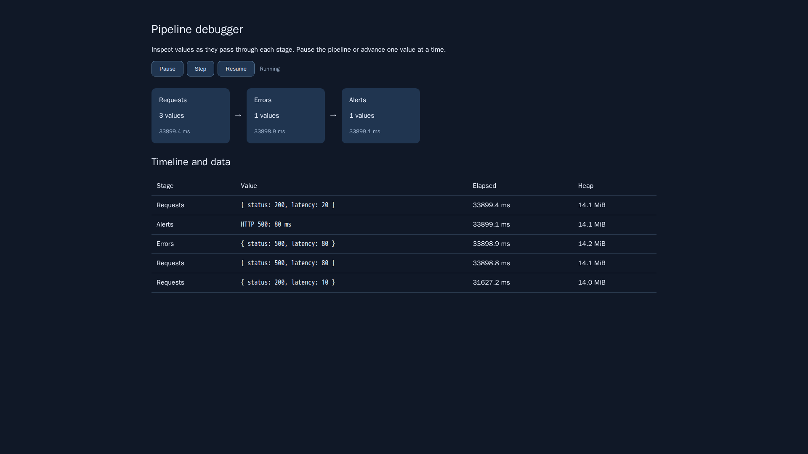

# Advanced command workflows

## Literal command builders

See the [complete command builder API](COMMAND-BUILDER.md) for fluent methods,
functional transforms, argv arrays, presets, sync execution and overrides.

```js
import $ from 'command-stream';
const cat = $.command('cat', 'file with spaces');
const code = await cat
  .pipe($.command.stdout('inherit'), $.command.exitCode)
  .run();
```

Builders are lazy and reusable. Arguments go directly to the executable, including
empty strings, quotes, `$`, newlines, and shell metacharacters. `with({cwd, env,
stdin, capture, mirror})` or `pipe(command.cwd(...), command.env(...), ...)`
returns a new builder. `stdout` and `stderr` accept `pipe`, `inherit`, or `ignore`.
Inherited and ignored output is not captured. `await builder` executes it;
`builder.stream()` streams it. `String(builder)` produces a POSIX shell command;
it does not encode environment, working directory, or stream configuration.
Run the builder itself for portable exact-argv execution.

## Shell-to-module translation

See the [source translation guide](FY.md) for CLI options, competitor migration,
`use-m` loading, and the structural rule-based translator.

```sh
npx command-stream fy deploy.sh deploy.mjs
node deploy.mjs staging
```

The `$fy` executable provides the same translation. `fy(source, {shell, name,
module})` returns an executable module. This is interpreter-backed translation:
the generated CLI module loads command-stream through use-m and passes the complete shell source
as a literal argument to the selected interpreter. Shell loops, expansions,
heredocs, pipelines, stdin, positional arguments, environment, and exit status
retain their shell behavior. It requires the original shell and command-stream
to be available, plus the use-m loader. The CLI recognizes sh/bash/dash/zsh shebangs. It creates output
files exclusively, so it does not overwrite an existing script. It does not
rewrite shell control flow into native JavaScript syntax.

## Processing and analytics

```js
await $.command('node', 'server.mjs')
  .with({ capture: false })
  .stream({ highWaterMark: 16, highWaterBytes: 262144 })
  .filter((line) => line.includes('ERROR'))
  .map((line) => ({ line, time: Date.now() }))
  .batch(100)
  .forEach((batch) => sendToAggregator(batch));
```

Raw `for await` iteration still yields stdout/stderr buffers and an exit chunk.
Fluent operators on a command stream frame stdout into UTF-8 lines; call
`.lines({stderr:true})` to include stderr explicitly. Generic `stream(iterable)`
preserves its values. `map`, `filter`, `reduce`, and `forEach` await callbacks.
`batch(n)` emits its final partial batch; `window(n, step)` emits complete sliding
windows. `take(n)` cancels upstream after n values. `merge(...streams)` emits
ready values with one pending read per input. `split(predicate, {highWaterMark})`
returns matching and nonmatching branches. Consume both concurrently or explicitly
cancel an unused branch with `.return()`; a full branch applies backpressure.

`.analyze({errorRate, responseTime, throughput, onUpdate})` computes count, errors,
error fraction, elapsed milliseconds, events per second, and response-time
count/mean/min/max without retaining the input. `onUpdate` receives each incremental
snapshot. Empty inputs have zero counts and response-time statistics. Response-time units are the
units returned by the callback. The monitoring example combines these metrics
with a terminal screen and can trigger alerts in `onUpdate`.

Pull-driven operators retain only their window/batch or bounded branch queues.
Native and generator output pumps wait for command-stream queue capacity.
Existing result-returning virtual handlers receive a complete stdin string;
feeding such a handler intentionally buffers its input. Use native stages or
stream operators for bounded incremental processing. One
already-read producer chunk may exceed the byte threshold. Use `capture:false`
for long-lived monitoring; capture and `.toArray()` intentionally collect output,
and a newline-free record necessarily occupies its line buffer. Event listeners
remain synchronous; async processing should use stream operators.

Run `node --max-old-space-size=128 experiments/issue-224/stream-memory.mjs stream`
and then `buffer` from the repository root for a finite 25.6 MB comparison. Each
mode runs separately and prints its elapsed time and observed RSS growth. Results
depend on runtime and allocator; measurements are recorded in the issue analysis.

## Packages, middleware, and reload

```js
$.create('hello', ({ args }) => ({ code: 0, stdout: args.join(' ') }));
$.inherit('greet', 'hello', { args: ['Hello'] });
$.extend('greet', async (context, next) => {
  const result = await next(context);
  return { ...result, stdout: `${result.stdout}!` };
});
const installed = await $.install('./commands.mjs');
await installed.reload();
installed.uninstall();
```

A package exports `{name, version, commands, descriptions?}`. Handlers receive
the existing virtual command context and may return a result or a synchronous
or asynchronous iterable, directly or through a promise. Middleware may wrap
either kind. `compose(...handlers)` pipes captured stdout into the next handler's
stdin and stops at a nonzero exit code; use generator pipelines for incremental
processing. `create(options)` continues to create configured `$` tags.

Installation accepts a module path or npm package name. Missing npm packages are
installed in `cwd` with lifecycle scripts disabled; `{install:false}` restricts
resolution to existing packages. All command names and collisions are validated
before registration. `{replace:true}` explicitly allows replacement, and
uninstallation restores displaced handlers. Invalid reloads retain the working
package. Reload uses a temporary sibling entry module on Node and Bun, preserving
relative imports. Imported dependencies retain the runtime's module cache;
restart the application to reload an entire dependency graph.

`$.marketplace.search('git')` searches npm's registry for the
`command-stream-command` keyword. It accepts a registry URL, fetch transport,
size, and AbortSignal. The ten standalone example packages include Git helpers,
deployment planning, files, JSON, text, HTTP, logs, time, environment, and math.
The enterprise example demonstrates scoped external-service mocks. They are
included examples; independent publication and adoption metrics are release outcomes.

## Development, REPL, debugger, and tests

See the [interactive development guide](INTERACTIVE-DEVELOPMENT.md) for JavaScript
syntax, the Rust evaluator, prerequisites, and Cargo watch/restart mode.

`$.dev({watch:['./scripts/*.mjs'],repl:true})` watches matching files and restarts
the current script after changes. `command-stream dev app.mjs 'scripts/**/*.mjs'`
starts immediately. Globs support `*`, `**`, and `?`; creation and deletion are
detected. Restarts are debounced and serialized, with the previous process killed
and awaited. Child processes do not recursively watch themselves. Set `entry:null`
and `packages:[installed]` for package-only reloads. Await `controller.ready` before
editing fixtures and `controller.close()` to stop and await work.

`npx command-stream repl` exposes `$` and the exported APIs inside Node's
JavaScript REPL. Evaluate JavaScript, await commands, register handlers, and run
bare shell commands. Completion includes registered commands and normal JavaScript
context completion. Existing zx script execution remains available through the
default command-stream CLI path.

```js
import { PipelineDebugger, stream } from 'command-stream';
const debug = new PipelineDebugger({ paused: true, history: 1000 });
const view = await debug.serve();
console.log(view.url);
const values = debug.stage('Input', stream([1, 2, 3]));
const processed = debug.stage(
  'Double',
  values.map((value) => value * 2)
);
const work = processed.forEach(console.log);
// Open the URL and use Step or Resume. Close explicitly after inspection.
```

The local browser view shows flow, bounded data previews, per-stage counts,
elapsed time, heap samples, errors, and a timeline. A step releases one gated
value across the pipeline. Duration includes time spent paused. `pause`, `step`,
`resume`, `visualize`, and `profile` are also available directly. The server binds
to 127.0.0.1 and requires its generated token. Resume paused work, await its
completion, and call `view.close()` when finished. The runnable debugger example
handles Ctrl+C this way.



The [VS Code extension](../../extensions/vscode-command-stream/README.md) provides
shell template syntax, command completion, hover documentation, shell quote
diagnostics, and a REPL command. Package it into a VSIX for local installation.
TypeScript declarations also cover all new APIs through ESM and CommonJS.

`testing.withMocks(mocks, callback)` records calls and restores registrations in
`finally`, including after failures. Mock scopes mutate the shared registry, so
serialize overlapping scopes. `expectOutput`, `expectPipeline`, and
`snapshot(file,value)` provide assertions; snapshot creation/update requires
`{update:true}`. See the development and integration tests for executable examples.

## Rust equivalents

Rust provides `CommandBuilder` with literal `OsString` arguments, cwd/env/stdin,
`CommandStdio`, reusable `run`, `exit_code`, and POSIX `shell_string`; `fy`
generates the same interpreter-backed JavaScript module with `sh`. The Rust CLI
also accepts `command-stream fy input.sh output.mjs`. `DataStream` supports
bounded stages, map/map_async/filter/reduce/for_each, batching, windows, split,
merge, and incremental statistics. `OutputStream::lines` frames stdout bytes.
Dropping a stream closes its receiver and aborts its producer.

`terminal::TerminalBuffer` uses vt100 with snapshots, colored/plain text, resize,
and bounded broadcast frame subscriptions. `CommandEnvironment` provides typed
closures, middleware, inherited commands, composition, and atomic packages.
`CommandPackage::load(path)` loads a JSON manifest whose commands contain `file`
and `args`; reinstall it after changes for safe hot reload without native dynamic
linking. Native `dev` and `start_repl` APIs provide Cargo watching and full Rust
evaluation via Evcxr. The npm ecosystem, JavaScript evaluator, VS Code integration,
and browser development tools belong to the JavaScript package. The executable feature catalog
includes Node, Bun, and Rust examples for the shared core APIs.
